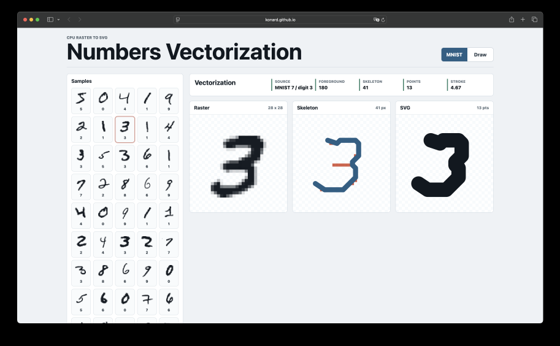
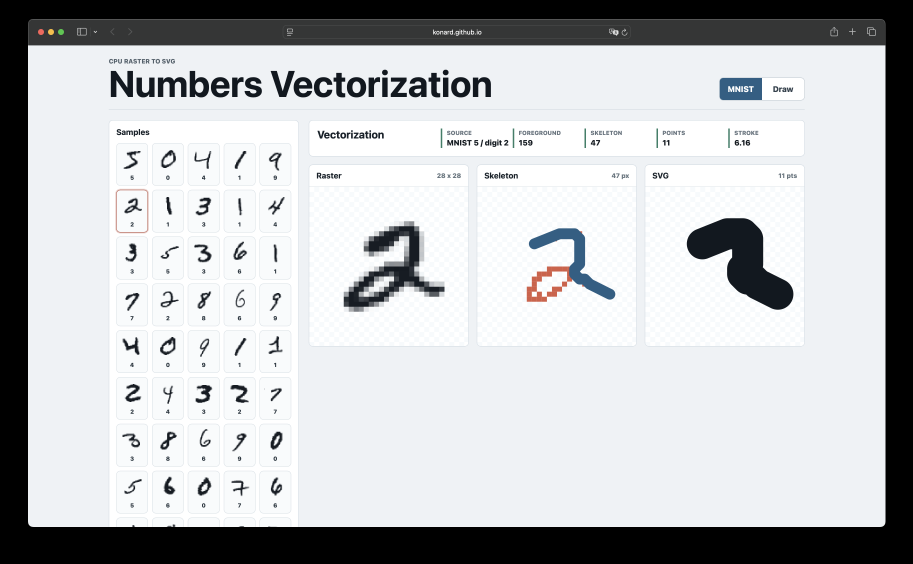
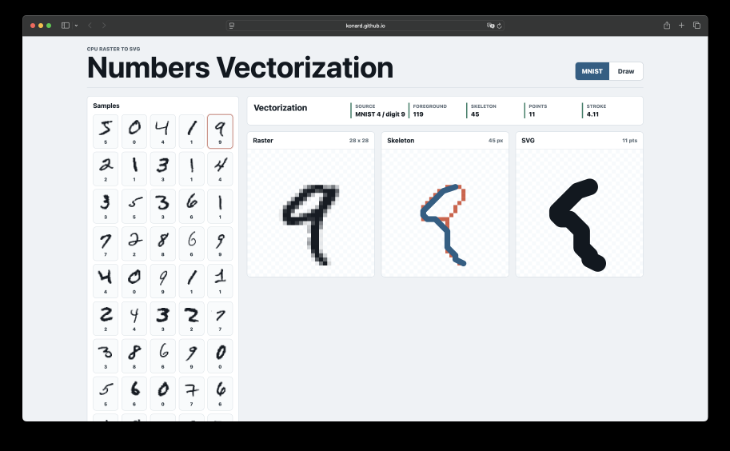
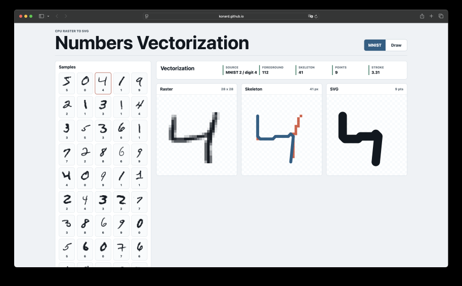
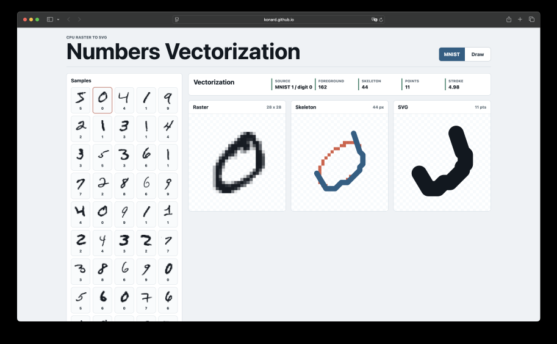
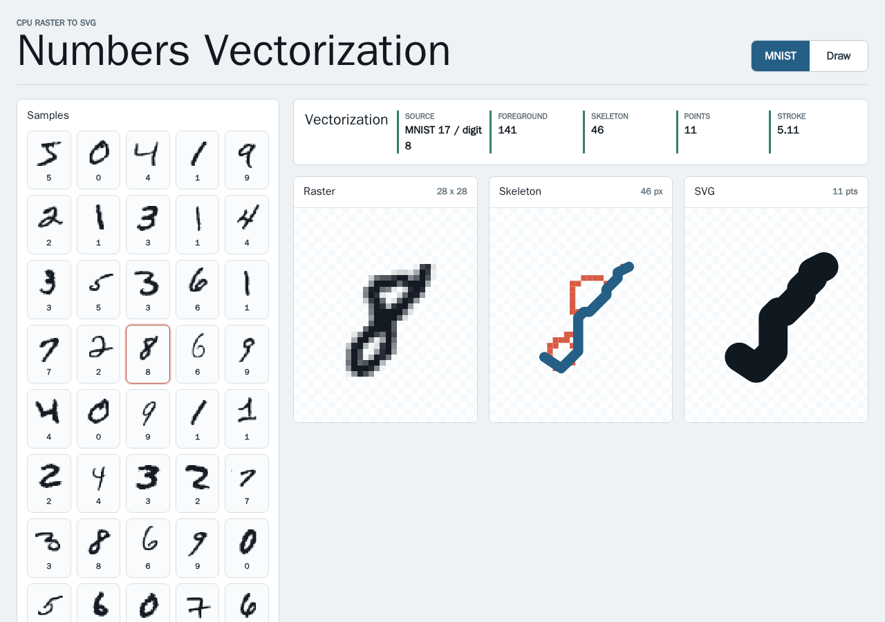
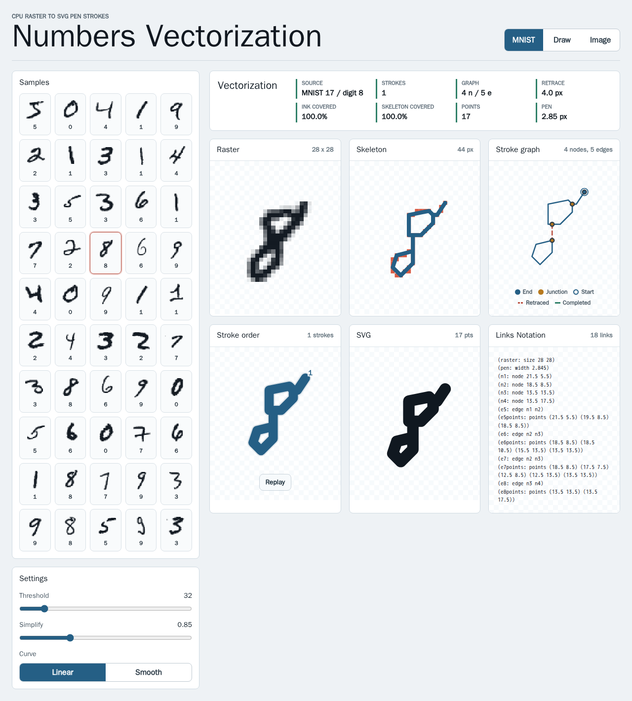
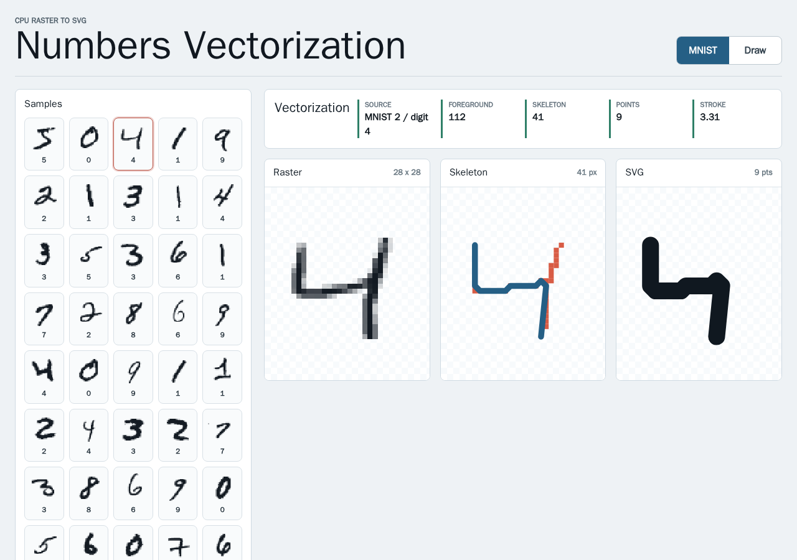
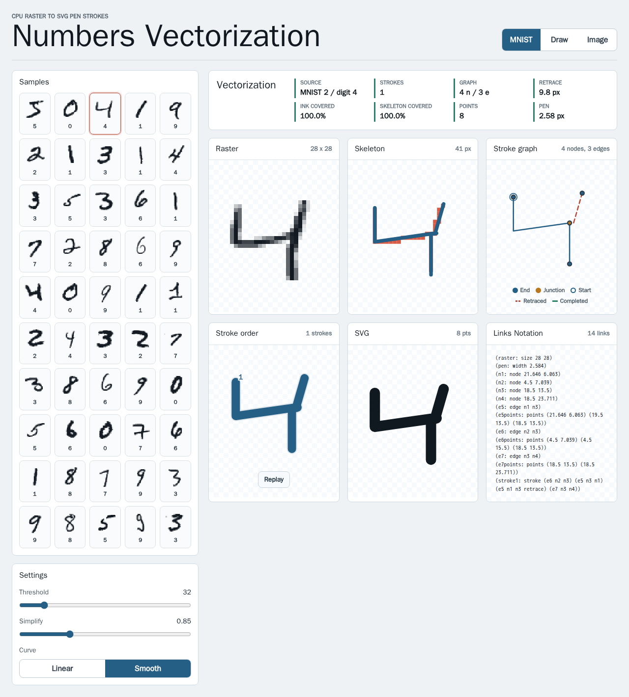
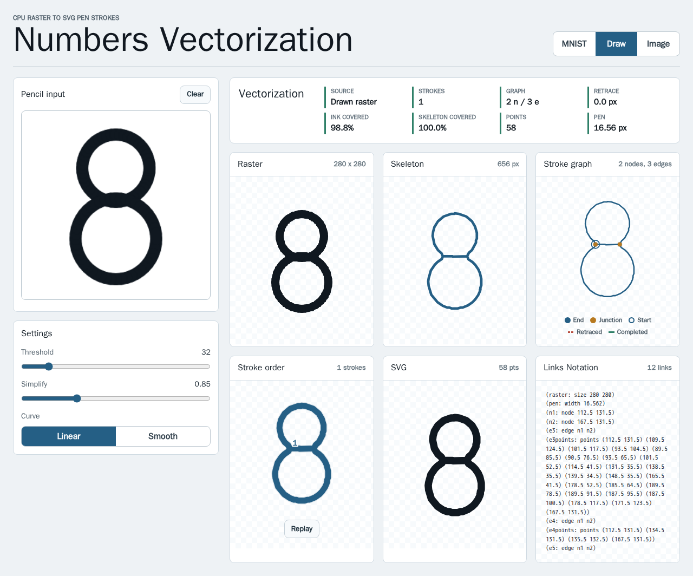

# Case study: issue #5 — general vectorization of loops, U-turns and complex paths

- Issue: [#5 "We need to make our vectorization logic much more general"](https://github.com/konard/numbers-vectorization/issues/5)
- Pull request: [#6](https://github.com/konard/numbers-vectorization/pull/6)
- Data: [`data/`](data) (raw experiment output), [`images/`](images) (the
  issue screenshots, downscaled 4× by
  [`experiments/issue-5-downscale-issue-images.mjs`](../../../experiments/issue-5-downscale-issue-images.mjs))

## 1. What the issue reports

The issue attaches five screenshots of the GitHub Pages demo. Each shows an
MNIST digit whose SVG output drops part of the digit. The red skeleton pixels
are the parts the vectorizer did not draw.

| Screenshot               | Sample / digit | What is lost                                                |
| ------------------------ | -------------- | ----------------------------------------------------------- |
|  | MNIST 7 / 3    | the middle arm of the 3 (a U-turn out and back)             |
|  | MNIST 5 / 2    | the whole bottom loop of the 2                              |
|  | MNIST 4 / 9    | half of the loop of the 9                                   |
|  | MNIST 2 / 4    | the right stem of the 4 above the crossing                  |
|  | MNIST 1 / 0    | the left half of the 0 (a closed loop drawn as an open arc) |

### Root cause

The original algorithm
([`experiments/baseline/index-before-issue-5.js`](../../../experiments/baseline/index-before-issue-5.js))
thinned the mask, found all skeleton endpoints, and emitted **only the longest
endpoint-to-endpoint path**. Any digit whose skeleton is not one simple path
lost pixels:

- **Closed loops** (0, 6, 8, 9, the bottom of a 2) have no endpoints on the
  loop, so the path enters the loop at the junction and leaves again, dropping
  one side.
- **Branches** (the arm of a 3, the stem of a 4, the tail of a 9) can only be
  reached by going out to the tip and coming back: a U-turn. A single simple
  path cannot do that.
- **Multiple components** (a broken 5, a 7 with a separate crossbar) kept only
  the longest one.

Measured on the 50 bundled MNIST samples
([`data/mnist-coverage.txt`](data/mnist-coverage.txt)), the old algorithm drew
a mean of **86.2 %** of the skeleton and **81.9 %** of the ink. Only
**19 / 50** digits were fully drawn.

## 2. Requirements

Every requirement in the issue text, and how this PR addresses it:

| #   | Requirement (from the issue)                                                                                    | Status | Where                                                                                                 |
| --- | --------------------------------------------------------------------------------------------------------------- | ------ | ----------------------------------------------------------------------------------------------------- |
| R1  | Make the vectorization logic much more general                                                                  | Done   | stroke graph + route inspection pipeline (§4)                                                         |
| R2  | Support shapes that need loops                                                                                  | Done   | loops are edges `(e: n n)` walked in one pass; tests `draws a closed loop…`, `draws an 8…`            |
| R3  | Support "move to a point, make the U-turn and come back"                                                        | Done   | Chinese postman retraces, `retrace: true` steps; tests `walks out and back…`, `plus`/`tee` shapes     |
| R4  | 100 % of the tests fully work: **all** numbers can be fully vectorized                                          | Done   | 50 / 50 MNIST samples have skeleton coverage 1 and every graph edge traversed (one test per sample)   |
| R5  | Check best practices online and take the best techniques                                                        | Done   | §3 research, §5 library evaluation                                                                    |
| R6  | Use the associative stack for loops and complex paths                                                           | Done   | `LinksStore` doublet graph, Links Notation export (§4.3)                                              |
| R7  | Available as a **library**                                                                                      | Done   | `import { vectorizeRasterLine } from '@link-foundation/example-package-name'` (+ `/node`, `/server`)  |
| R8  | Available as a **CLI**                                                                                          | Done   | `example-package-name vectorize <file>` (PNG, PBM/PGM/PPM, JSON, ASCII art)                           |
| R9  | Available as an **API server**                                                                                  | Done   | `example-package-name serve`: `GET /health`, `POST /vectorize`                                        |
| R10 | **Docker** image with the API server preinstalled                                                               | Done   | [`Dockerfile`](../../../Dockerfile), smoke-tested in [`data/docker-smoke.txt`](data/docker-smoke.txt) |
| R11 | Keep the main focus on the GitHub Pages web application                                                         | Done   | web app gains stroke graph, stroke-order replay, curve toggle, image upload and Links Notation panels |
| R12 | Collect data in `./docs/case-studies/issue-5`, deep case study, list of requirements, solutions, existing tools | Done   | this document, [`data/`](data), [`images/`](images)                                                   |
| R13 | Everything in a single pull request                                                                             | Done   | [PR #6](https://github.com/konard/numbers-vectorization/pull/6)                                       |

## 3. Online research

### 3.1 Thinning (skeletonization)

- T. Y. Zhang and C. Y. Suen, _A fast parallel algorithm for thinning digital
  patterns_, Communications of the ACM 27(3):236–239, 1984,
  [doi:10.1145/357994.358023](https://doi.org/10.1145/357994.358023). This is
  the two-sub-iteration parallel thinning already used by the package.
- Known weaknesses:
  [_A comment on "A fast parallel algorithm for thinning digital patterns"_](https://cacmb4.acm.org/magazines/1986/3/10253-a-comment-on-a-fast-parallel-algorithm-for-thinning-digital-patterns)
  (CACM, March 1986) and later papers report that diagonal strokes two pixels wide can be eroded and
  that spurs ("parasitic branches") appear at the corners of thick strokes.
  We handle both on the graph rather than in the thinning:
  - spur pruning, with a length threshold derived from the distance transform;
  - endpoint extension back to the ink boundary;
  - coverage completion: ink that the skeleton misses is reconnected with
    geodesic paths along the medial axis.

### 3.2 Pen width from the distance transform

- P. F. Felzenszwalb and D. P. Huttenlocher,
  [_Distance Transforms of Sampled Functions_](https://theoryofcomputing.org/articles/v008a019/),
  Theory of Computing 8:415–428, 2012. This is a simple, exact, linear-time
  Euclidean distance transform built from two separable 1-D
  lower-envelope-of-parabolas passes.
- Implemented in [`src/distance.js`](../../../src/distance.js). A skeleton
  pixel of a stroke `w` px wide lies about `(w + 1) / 2` px from the
  background. The median over the skeleton gives the pen width. That width
  drives the spur, contraction, extension and completion thresholds, so the
  same code works on 28 px MNIST digits and 280 px canvas drawings.

### 3.3 Thresholding

- N. Otsu,
  _A Threshold Selection Method from Gray-Level Histograms_, IEEE Trans. SMC
  9(1):62–66, 1979,
  [doi:10.1109/TSMC.1979.4310076](https://doi.org/10.1109/TSMC.1979.4310076).
  `foreground: 'auto'` picks the ink polarity (the minority class) and an Otsu
  threshold. The CLI, the API server and the web app's Image mode use it for
  arbitrary photos and scans.

### 3.4 Skeleton → graph → drawing order

The literature on recovering the drawing order of off-line handwriting
converges on one pipeline:

1. Build a graph from the skeleton: endpoints and junctions become nodes, and
   the pixel chains between them become edges. Degree-2 nodes are collapsed.
2. Find a traversal that covers every edge.
3. Use smoothness (minimum turning) to choose among the possible
   continuations at junctions.

Sources:

- Y. Kato and M. Yasuhara, _Recovery of drawing order from single-stroke
  handwriting images_ (IEEE TPAMI 22(9), 2000), and the follow-up by Qiao et
  al. at IWFHR-9, 2004
  ([PDF](https://rdg.ext.hitachi.co.jp/iwfhr9/AfterWS/IWFHR9-Proceedings/docs/020_qiao-RecoveringD.pdf)).
  Lines that are written twice (D-lines, i.e. U-turns) must be
  detected and duplicated before the graph becomes semi-Eulerian.
- [_Restoration of temporal information in off-line Arabic handwriting_](https://datalearner.com:8443/academic/journal-papers/0031-3203/volumes-and-issues/159/paper-detail/96446)
  (Pattern Recognition, accepted 1993). Each stroke is traversed from a start vertex to
  an end vertex by solving the **Chinese postman problem** on its graph. This
  restored the real temporal order in 96.5 % of 2256 strokes.
- J. Edmonds and E. L. Johnson,
  [_Matching, Euler tours and the Chinese postman_](https://web.eecs.umich.edu/~pettie/matching/Edmonds-Johnson-chinese-postman.pdf),
  Mathematical Programming 5:88–124, 1973. The postman tour is optimal when
  the odd-degree vertices are paired by a minimum-weight perfect matching on
  shortest-path distances. Every matched path is then duplicated, and an Euler
  trail is read off the result ([route inspection
  problem](https://en.wikipedia.org/wiki/Chinese_postman_problem)).
- Fleury's algorithm (never cross a bridge unless forced) gives a valid Euler
  trail. Among the valid continuations we pick the one with the smallest turn
  angle, following the "smoothest path" criterion of the drawing-order papers.

### 3.5 Associative technology stack

[`associative-tech-stack.md`](https://github.com/link-assistant/formal-ai/blob/main/docs/associative-tech-stack.md)
describes knowledge as a **doublets** network:

- every link is `(id: source target)`, and links may point at links;
- the network is stored by `doublets-rs` / `link-cli` on native targets and by
  `doublets-web` / IndexedDB in browsers;
- [Links Notation](https://github.com/link-foundation/links-notation) is its
  portable, human-readable serialization.

A stroke graph maps onto this model directly. A node is a point link
`(n: n n)`, a branch is a doublet `(e: n1 n2)`, and a closed loop is the
doublet `(e: n n)`. Graph rewriting (pruning, contraction, merging,
completion) is a sequence of plain `create` / `update` / `delete` operations
on links.

## 4. Solution

### 4.1 Pipeline

```
raster ─► mask (threshold / Otsu, alpha) ─► fill ≤2 px holes
      ─► Zhang–Suen thinning ─► exact EDT ─► pen width
      ─► skeleton graph (m-adjacency) in a doublet LinksStore
      ─► prune spurs ─► contract junction clusters ─► merge degree-2 nodes
      ─► extend free ends to the ink boundary
      ─► coverage completion (medial-axis geodesics for missed ink)
      ─► simplify each edge (Douglas–Peucker + corner keeping)
      ─► Chinese postman: pair odd nodes (exact bitmask DP ≤16, greedy above)
      ─► Fleury trail with minimum-turn continuation, one stroke per component
      ─► SVG path (linear or smooth cubic Bézier), SVG document, Links Notation
      ─► coverage metrics (skeleton, ink mask, precision, edges traversed)
```

| Stage                    | Module                                                                |
| ------------------------ | --------------------------------------------------------------------- |
| Mask, Otsu, components   | [`src/raster.js`](../../../src/raster.js)                             |
| Thinning                 | [`src/thinning.js`](../../../src/thinning.js)                         |
| Distance transform       | [`src/distance.js`](../../../src/distance.js)                         |
| Skeleton graph + cleanup | [`src/stroke-graph.js`](../../../src/stroke-graph.js)                 |
| Doublet store            | [`src/links-store.js`](../../../src/links-store.js)                   |
| Coverage completion      | [`src/completion.js`](../../../src/completion.js)                     |
| Spatial grid             | [`src/segment-grid.js`](../../../src/segment-grid.js)                 |
| Postman + Euler trail    | [`src/traversal.js`](../../../src/traversal.js)                       |
| SVG                      | [`src/svg.js`](../../../src/svg.js)                                   |
| Links Notation           | [`src/links-notation.js`](../../../src/links-notation.js)             |
| Coverage metrics         | [`src/coverage.js`](../../../src/coverage.js)                         |
| Decoders, output formats | [`src/node.js`](../../../src/node.js)                                 |
| HTTP API                 | [`src/server.js`](../../../src/server.js)                             |
| CLI                      | [`bin/example-package-name.js`](../../../bin/example-package-name.js) |

### 4.2 Loops and U-turns

- A **loop** is an edge whose source and target are the same node, or a cycle
  of edges. All of its nodes have even degree, so the Euler trail walks around
  it once and returns. A lone ring (a 0) becomes a single closed subpath.
- A **U-turn** shows up as an odd-degree node, such as a branch tip or a
  T-junction. The postman step pairs odd nodes and duplicates the cheapest
  connecting paths. The trail then walks out to the tip and back over the
  duplicated edge. Those steps carry `retrace: true`, and
  `stroke.retraceLength` reports their length.
- **Separate components** (a 5 written in two strokes, `=`) become separate
  strokes, i.e. separate `M` subpaths. Each starts at its top-left endpoint
  and is ordered top-left first.
- **Dots** (single-pixel or blob components) become zero-length strokes, so
  they still render with a round cap.

### 4.3 The doublet store and Links Notation

`LinksStore` keeps links in a `Map` with source and target indexes, and keeps
the payload (coordinates and pixel chains) in a side table. This keeps the
structure a pure doublet graph.
`result.links` exposes the store, and `result.lino` is the same graph and its
strokes in Links Notation. Tests parse it with the official
[`links-notation`](https://www.npmjs.com/package/links-notation) parser. For
MNIST sample 8 / digit 8:

```
(raster: size 28 28)
(pen: width 2.306)
(n1: node 13 15)
(n4: node 19.5 7.5)
(n6: node 21.03 5.97)
(e2: edge n1 n4)
(e3: edge n1 n1)
(e5: edge n4 n1)
(e7: edge n4 n6)
(stroke1: stroke (e5 n4 n1) (e3 n1 n1) (e2 n1 n4) (e7 n4 n6))
```

(`eNpoints` lines omitted.) `e3` is the bottom loop `(e3: edge n1 n1)`, and
the stroke walks around it in one pass.

### 4.4 Coverage completion

Thinning can miss ink. A blob where two thick strokes cross may thin to a
point, and a short stub may be pruned as a spur. After the graph is built, we
compute the ink that the pen (path plus stroke width) does not reach. For each
uncovered component, largest first, we run a Dijkstra search that prefers the
medial axis (cost grows as the distance to the background shrinks) to the
deepest uncovered pixel. The geodesic is then added as a new edge, flagged
`completed: true` in `result.graph.edges`.

A branch is accepted only if it reaches at least half a pen radius beyond the
existing stroke body. This rule came from the overlapping thick loops of a
hand-drawn 8: without it, completion added short U-turn stubs into the blob
where the loops overlap (test _adds no U-turn stubs where two thick pen loops
overlap_).

### 4.5 Performance

A warm 280×280 canvas drawing of an 8 (pen ≈ 17 px) vectorizes in about
120–280 ms in Node 26 on the development VM used for this PR, and a 28×28 MNIST digit
in a few milliseconds ([`data/drawing-performance.txt`](data/drawing-performance.txt)).
The main optimizations:

- a uniform segment grid shared by coverage measurement and completion,
  replacing an O(pixels × segments) scan;
- a binary heap kept in parallel typed arrays;
- an allocation-free flood fill in `labelComponents`.

## 5. Existing components and libraries

| Tool                                                                                                      | Kind                            | Centerline?                  | Why it is (not) used                                                                                                                                                                                                                       |
| --------------------------------------------------------------------------------------------------------- | ------------------------------- | ---------------------------- | ------------------------------------------------------------------------------------------------------------------------------------------------------------------------------------------------------------------------------------------ |
| [Potrace](https://potrace.sourceforge.net/)                                                               | C, outline tracer               | No, traces filled boundaries | Produces outlines (two curves per stroke), not pen strokes. No stroke order, no U-turns.                                                                                                                                                   |
| [AutoTrace](https://github.com/autotrace/autotrace)                                                       | C, outline + `-centerline` mode | Yes                          | Only established open-source centerline tracer ([Inkscape wiki](https://lists.inkscape.org/hyperkitty/list/inkscape-user@lists.inkscape.org/message/UOA7QD63FWAG6AY7EBTC6HAIIKSOTAMA/)). Native binary, no stroke order, no browser build. |
| [imagetracerjs](https://www.npmjs.com/package/imagetracerjs)                                              | JS, outline tracer              | No                           | Pure JS and browser-friendly, but outline-based like Potrace.                                                                                                                                                                              |
| [VTracer](https://github.com/visioncortex/vtracer)                                                        | Rust/WASM, color outline tracer | No                           | Good for color art; output is filled shapes.                                                                                                                                                                                               |
| [scikit-image `skeletonize`](https://scikit-image.org/docs/stable/auto_examples/edges/plot_skeleton.html) | Python, thinning                | Skeleton pixels only         | Same role as our Zhang–Suen step; Python only.                                                                                                                                                                                             |
| [Skan](https://github.com/jni/skan) ([PeerJ 2018](https://peerj.com/articles/4312/))                      | Python, skeleton → graph        | Graph of branches/junctions  | The same skeleton-to-graph step we implement; Python only, no traversal.                                                                                                                                                                   |
| [NetworkX](https://networkx.org/) `eulerize` / `eulerian_path`                                            | Python, graph algorithms        | n/a                          | Reference for the postman step; Python only.                                                                                                                                                                                               |
| [JGraphT `ChinesePostman`](https://jgrapht.org/javadoc-1.4.0/org/jgrapht/alg/cycle/ChinesePostman.html)   | Java, graph algorithms          | n/a                          | Reference implementation of Edmonds–Johnson; JVM only.                                                                                                                                                                                     |
| [links-notation](https://github.com/link-foundation/links-notation)                                       | JS/Rust/…, notation parser      | n/a                          | **Used** (dev dependency) to validate our Links Notation export in tests.                                                                                                                                                                  |
| [doublets-web](https://github.com/linksplatform/doublets-web)                                             | Browser doublets store          | n/a                          | Compatibility target; our `LinksStore` has the same `(id: source target)` shape, in-memory and dependency-free.                                                                                                                            |

**Conclusion:** no JavaScript library combines centerline extraction,
loop/U-turn-aware stroke ordering, and a browser + Node + Deno + Bun build
without native code. The package therefore keeps a dependency-free
implementation of the established techniques from §3, with the doublet model
from the associative stack as its graph store.

### Alternatives considered

| Option                                                      | Verdict                                                                                                                                           |
| ----------------------------------------------------------- | ------------------------------------------------------------------------------------------------------------------------------------------------- |
| Keep the longest path and add the rest as separate subpaths | Rejected. It covers the ink but breaks a 3 or 4 into several pen lifts and has no U-turns.                                                        |
| Travelling-salesman ordering of edges (Jäger)               | Rejected. NP-hard. The postman formulation is polynomial and exact for our graph sizes.                                                           |
| Exact Edmonds blossom matching                              | Not needed. Digits have ≤ 16 odd nodes, where an exact bitmask DP is simpler and exact. A greedy fallback handles larger drawings.                |
| Learned stroke recovery (neural)                            | Rejected for now. It needs training data and a runtime and is not CPU-only / dependency-free. It could be explored on top of the graph.           |
| Use `doublets-web` / `link-cli` as the store                | Deferred. Needs WASM/native code in every runtime. The in-memory `LinksStore` keeps the same model, and Links Notation is the interchange format. |

## 6. Results

### 6.1 MNIST (50 bundled samples)

From [`experiments/issue-5-coverage.mjs`](../../../experiments/issue-5-coverage.mjs)
([`data/mnist-coverage.txt`](data/mnist-coverage.txt)):

|                                | Before | After      |
| ------------------------------ | ------ | ---------- |
| Mean skeleton coverage         | 86.2 % | **100 %**  |
| Mean ink (mask) coverage       | 81.9 % | **98.1 %** |
| Minimum ink coverage           | —      | 93.2 %     |
| Mean precision (path on ink)   | —      | 100 %      |
| Digits with every branch drawn | 19/50  | **50/50**  |

The five digits from the issue:

| Sample / digit | Before skeleton / ink | After skeleton / ink | Strokes | Retrace (px)               |
| -------------- | --------------------- | -------------------- | ------- | -------------------------- |
| MNIST 7 / 3    | 90.2 % / 83.3 %       | 100 % / 98.3 %       | 1       | 7.9 (middle arm of the 3)  |
| MNIST 5 / 2    | 53.2 % / 61.0 %       | 100 % / 96.3 %       | 1       | 0 (loop walked in place)   |
| MNIST 4 / 9    | 82.2 % / 67.2 %       | 100 % / 95.0 %       | 1       | 0                          |
| MNIST 2 / 4    | 80.5 % / 77.7 %       | 100 % / 100 %        | 1       | 9.8 (stem above the cross) |
| MNIST 1 / 0    | 75.0 % / 67.9 %       | 100 % / 96.9 %       | 1       | 0 (closed loop)            |

The remaining uncovered ink (≤ 7 %) is anti-aliasing and the outer corners of
thick strokes that a round pen of the estimated width does not reach. No
branch or loop is dropped.

### 6.2 Synthetic shapes

[`data/synthetic-shapes.txt`](data/synthetic-shapes.txt) lists `zero`,
`eight`, `six`, `plus`, `tee`, `equals`, `dot` and `block`. All reach 100 %
skeleton and ink coverage. `plus` and `tee` are single strokes with U-turns,
and `equals` becomes two strokes.

### 6.3 Web app

| Before                                                    | After                                                   |
| --------------------------------------------------------- | ------------------------------------------------------- |
|  |  |
|  |  |

Drawn 8 (overlapping thick loops, one stroke, no retrace) and an uploaded scan
of "38" (Otsu threshold, two strokes):




## 7. Tests

- [`tests/stroke-traversal.test.js`](../../../tests/stroke-traversal.test.js):
  - loops, 8, 6, plus, tee, `=`, dots;
  - U-turn retraces, smooth curves, overlapping thick pen loops;
  - the `completed` flag and Links Notation round-trip;
  - the LinksStore API and a hand-built postman plan;
  - **one test per MNIST sample** asserting skeleton coverage 1, every edge
    traversed, ink ≥ 90 %, precision ≥ 99 % and one `M` per stroke.
- [`tests/node-io.test.js`](../../../tests/node-io.test.js): PNG (all color
  types, bit depths and filters), PBM/PGM/PPM, ASCII art and JSON decoders, the
  CLI `vectorize` command and the HTTP API.
- [`tests/vectorization.test.js`](../../../tests/vectorization.test.js) and
  [`tests/index.test.js`](../../../tests/index.test.js): the existing API
  (`add`, `multiply`, `delay`, `rasterToSvgPath`) keeps working.

## 8. Remaining limits

- The drawing order is a plausible pen order (top-left start, minimum turning
  at junctions), not the writer's real order. Off-line images do not contain
  that information.
- Where two strokes cross at a very shallow angle, thinning can merge them
  into a short shared segment. The postman route still covers everything, but
  the crossing is drawn as a junction rather than an "X".
- Very large or noisy images with more than 16 odd nodes per component use a
  greedy pairing, which may retrace more than an optimal postman tour would.
