# Case study: issue #7 — the simplest explanation of every shape

- Issue: [#7](https://github.com/konard/numbers-vectorization/issues/7)
- Pull request: [#8](https://github.com/konard/numbers-vectorization/pull/8)
- Data: [`data/`](data) (raw experiment output), [`images/`](images) (issue
  screenshots and before/after renders)
- Baseline: `main` at `a9b36c0` (after issues #1, #3 and #5)

## 1. What the issue reports

The issue attaches three screenshots of the web app. All three show one hand
drawn "4" whose top is a loop. Only the width of the loop changes:

| Screenshot                       | Loop                      | Stroke graph (old name) | SVG points | Retrace  |
| -------------------------------- | ------------------------- | ----------------------- | ---------- | -------- |
| 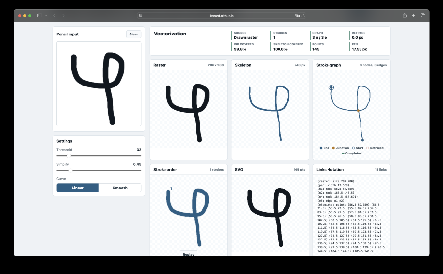 | open, both sides apart    | 3 nodes / 3 edges       | 145        | 0        |
| 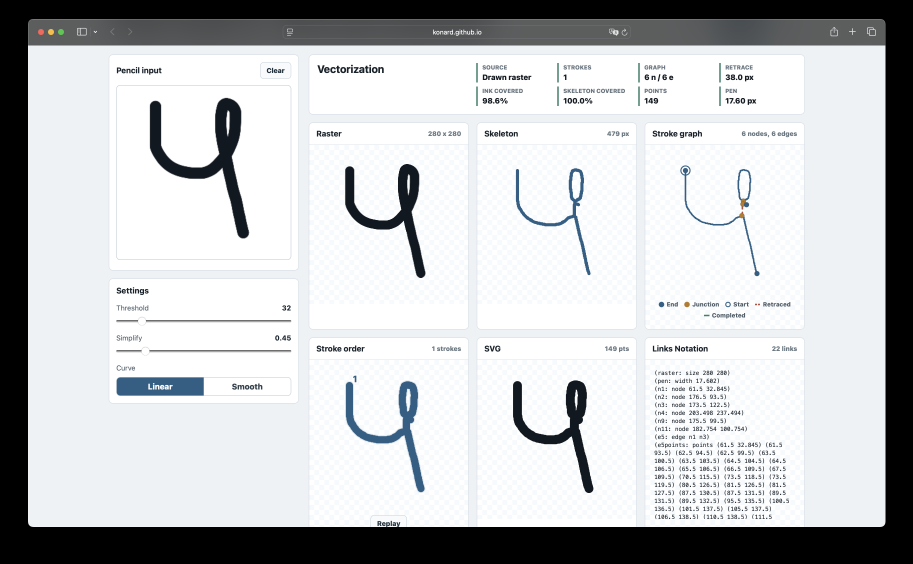    | narrow, sides almost meet | 6 nodes / 6 edges       | 149        | 38 px    |
| 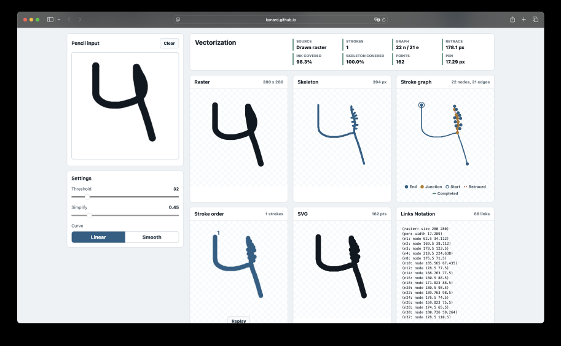    | sides fused into one blob | 22 nodes / 21 edges     | 162        | 178.1 px |

The first screenshot is what the issue asks for: one loop, three nodes. As
the loop closes, thinning turns the two touching sides into a single thick
blob. The skeleton of that blob grows a spine with many short side branches.
The old pipeline drew each branch as a U-turn. The result was a zig-zag
(screenshot 2) or a "fishbone" (screenshot 3).

The issue then widens the scope:

- the simplest explanation should win in every case;
- pen movement should be recorded;
- `+`, `x` and a barred 7 should be two separate lines;
- shapes should use the fewest points, tuned automatically, with manual control
  down to one point per shape;
- every setting should be manual or automatic;
- the terminology should follow the associative stack (links, not graphs);
- the output should use the indented Links Notation;
- this case study is required.

### Root causes (measured, not guessed)

Reproduced with [`experiments/issue-7-four-loop.mjs`](../../../experiments/issue-7-four-loop.mjs)
and [`experiments/issue-7-before-after.mjs`](../../../experiments/issue-7-before-after.mjs)
on a synthetic "4" whose loop gap shrinks from 30 px to 0 px:

1. **Fused loops became fishbones.** A loop narrower than about two pen
   widths thins into one spine with stubs: 22 points / 21 links at a 14 px
   gap on `main`. Each stub was a dead end, so the Chinese-postman route
   walked out and back along it: 180.5 px retraced. The narrow-loop case
   (6 nodes) is the same effect with fewer stubs.
2. **Crossings were drawn as one stroke.** The route always minimised pen
   lifts, so it retraced. A `+` was drawn as one stroke with a U-turn in each
   arm: 139.8 px retraced. People draw a `+` as two strokes.
3. **The point count used one global tolerance.** Ramer–Douglas–Peucker
   (RDP) ran with a fixed 0.85 px tolerance. This kept every pixel step of a
   long diagonal: 33 points for the open "4" where 9–15 explain the ink.
4. **No record of the input.** Only the rasterized image existed. A bug
   report could not reproduce the exact stroke that caused a problem.

## 2. Requirements

| #   | Requirement (from the issue)                                                                                                  | Status | Solution                                                                                                                                                                                                                                     | Verified by                                                                                                                                                                                                                                                             |
| --- | ----------------------------------------------------------------------------------------------------------------------------- | ------ | -------------------------------------------------------------------------------------------------------------------------------------------------------------------------------------------------------------------------------------------- | ----------------------------------------------------------------------------------------------------------------------------------------------------------------------------------------------------------------------------------------------------------------------- |
| R1  | Record the original movement, so error reports have more data                                                                 | Done   | [`src/pen-recording.js`](../../../src/pen-recording.js): timed `x y t pressure` samples per stroke, Links Notation and JSON, rasterized like the pencil; the web app records, replays, saves and loads them; CLI and HTTP server accept them | `tests/pen-recording.test.js`, `tests/universal-app-settings.test.js` (recordings), `tests/node-io.test.js` (`vectorizes pen recordings saved as Links Notation or JSON`), [`draw-recording.png`](../../screenshots/issue-7/draw-recording.png)                         |
| R2  | Use the indented structured Links Notation, as in lino-objects-codec                                                          | Done   | [`src/links-notation.js`](../../../src/links-notation.js) writes `vectorization:` / `network:` / `strokes:` blocks; recordings use `recording:` / `strokes:` / `samples:`                                                                    | `tests/stroke-traversal.test.js` (`exports the stroke network as indented Links Notation`), `tests/pen-recording.test.js` (`writes Links Notation that nests strokes and samples`), parsed back with `links-notation`                                                   |
| R3  | No zig-zags or fishbones for semi-loop and lasso shapes; screenshot 1 is the simplest network                                 | Done   | [`src/hairpin.js`](../../../src/hairpin.js) detects ink wider than the median pen and explains it as a folded loop; [`src/completion.js`](../../../src/completion.js) only adds a branch that explains most of its ink                       | `tests/simplest-explanation.test.js`: 3 points / 3 links at every gap from 60 px to 3 px, no retrace; a pressed line stays one link                                                                                                                                     |
| R4  | Double-check all other cases, follow best practices, add more test cases                                                      | Done   | multi-stroke shapes (`+`, `x`, `T`, barred 7, `A`, open 4), loop gaps 30–0 px, pressure lines, kinks, recordings, the 50 MNIST samples; §3 research                                                                                          | `tests/helpers/issue-7-shapes.js`, `pen-lifts`, `simplification`, `simplest-explanation`, `thresholding` tests; `MNIST samples are fully vectorized` (50/50, `tests/stroke-traversal.test.js`); per-digit numbers in [`data/mnist-strokes.txt`](data/mnist-strokes.txt) |
| R5  | `+`, `x` and a barred 7 are two separate lines                                                                                | Done   | the pen lifts when retracing would cost more than `penLiftCost` pen widths; at a crossing the stroke continues straight ([`src/continuation.js`](../../../src/continuation.js), [`src/traversal.js`](../../../src/traversal.js))             | `tests/pen-lifts.test.js`: 2 straight strokes with 0 retrace for each shape ([`data/pen-lifts.txt`](data/pen-lifts.txt)); the recorded barred 7 is 2 strokes                                                                                                            |
| R6  | Fewest points per shape, auto-adjusted per shape; manual simplification down to one point per shape                           | Done   | [`src/simplification.js`](../../../src/simplification.js): per shape, the tolerance with the shortest description (pixels wrong + `pointCost` pen-width squares per point); `maxPoints` budget down to 1                                     | `tests/simplification.test.js` (tolerance per shape, budgets 1–4, one dot per shape); [`data/simplification.txt`](data/simplification.txt)                                                                                                                              |
| R7  | Every setting adjustable manually, yet matched automatically to the task                                                      | Done   | library: `foreground: 'auto'`, Otsu threshold, per-shape tolerance and pen width when not given; `result.settings` reports each value and `automatic[]`; web app: an Auto switch on every slider, starting from the value Auto chose         | `tests/thresholding.test.js`, `tests/universal-app-settings.test.js`; [`mnist-auto-settings.png`](../../screenshots/issue-7/mnist-auto-settings.png), [`loaded-recording-manual.png`](../../screenshots/issue-7/loaded-recording-manual.png)                            |
| R8  | State-of-the-art quality; keep everything from issues #1, #3 and #5                                                           | Done   | all earlier tests still pass; MNIST: 505 → 325 SVG points, 146 → 63 px retraced, the same skeleton coverage (1.000)                                                                                                                          | `tests/stroke-traversal.test.js` (issue 5), `tests/vectorization.test.js`, `tests/universal-app.test.js`; table in §4                                                                                                                                                   |
| R9  | Associative-stack terminology: links, not graphs; "stroke graph" becomes "stroke network"                                     | Done   | `result.network` with `points` / `links` (`result.graph` kept as a deprecated alias); `LinksStore.links()`; the web app says "Stroke network"                                                                                                | `tests/stroke-traversal.test.js` (`names the result a stroke network of points and links`)                                                                                                                                                                              |
| R10 | Case study in `docs/case-studies/issue-7`: data, online facts, requirements with solutions, existing components and libraries | Done   | this document, [`data/`](data), [`images/`](images)                                                                                                                                                                                          | —                                                                                                                                                                                                                                                                       |
| R11 | Everything in one pull request                                                                                                | Done   | [PR #8](https://github.com/konard/numbers-vectorization/pull/8)                                                                                                                                                                              | —                                                                                                                                                                                                                                                                       |

## 3. Online research and best practices

### 3.1 Simplicity against fidelity

- J.-D. Favreau, F. Lafarge, A. Bousseau, _Fidelity vs. Simplicity: a Global
  Approach to Line Drawing Vectorization_, ACM TOG 35(4), SIGGRAPH 2016
  ([HAL hal-01309271](https://hal.archives-ouvertes.fr/hal-01309271)). This is
  the closest published statement of the issue's request. Earlier methods
  produced "too many short curves" at spurious junctions of thick strokes.
  The paper instead trades fidelity against the number of curves in one
  global optimization and keeps the simplest topology at junctions. We use
  the same trade-off in a cheaper form:
  - a branch must explain its own ink to exist (`completion.js`);
  - wide ink is a folded loop, not a spine with stubs (`hairpin.js`);
  - a point must pay for itself in ink (`simplification.js`).
- M. Bessmeltsev, J. Solomon, _Vectorization of Line Drawings via PolyVector
  Fields_, ACM TOG 38(1), 2019 ([arXiv 1801.01922](https://arxiv.org/abs/1801.01922)).
  It identifies junctions as the place where vectorizers get connectivity
  wrong. It also describes Favreau et al. as the better choice "when
  significant simplification of the curve network is needed". Our inputs
  (digits and single letters) need exactly that, so we follow the
  simplification approach and not frame fields.
- J. Rissanen, _Modeling by shortest data description_, Automatica 14(5),
  1978, [doi:10.1016/0005-1098(78)90005-5](<https://doi.org/10.1016/0005-1098(78)90005-5>).
  This is the minimum description length (MDL) principle: the model with the
  shortest total description wins. `simplifyShapes` scores each candidate
  tolerance per shape. The score is the misexplained pixels plus `pointCost`
  pen-width squares per point, and the lowest score wins. Measured in pen
  widths, the result does not depend on resolution.

### 3.2 Fewest points

- D. H. Douglas, T. K. Peucker, _Algorithms for the reduction of the number of
  points required to represent a digitized line or its caricature_, The
  Canadian Cartographer 10(2):112–122, 1973. This is the Ramer–Douglas–Peucker
  (RDP) algorithm, which we already used. With a point budget we now run it
  top-down over all strokes of a shape at once. The farthest-off point of any
  stroke is added first, so a budget of 4 goes to the corner of the 7 before
  any detail of its bar (test `spends a small budget on the corner of the 7`).
- M. Visvalingam, J. D. Whyatt, _Line generalisation by repeated elimination
  of points_, The Cartographic Journal 30(1):46–51, 1993
  ([doi:10.1179/000870493786962263](https://doi.org/10.1179/000870493786962263)).
  This method removes the point with the smallest "effective area" first. We
  kept RDP because its tolerance is a distance, which matches the pen-width
  error model. Like the effective-area idea, a point is kept only for the ink
  area it explains.

### 3.3 Stroke order and pen lifts

- J. Edmonds, E. L. Johnson, _Matching, Euler tours and the Chinese postman_,
  Mathematical Programming 5:88–124, 1973
  ([PDF](https://web.eecs.umich.edu/~pettie/matching/Edmonds-Johnson-chinese-postman.pdf)).
  This is the optimal edge-covering walk used since issue #5. Issue #7 adds a
  cost to a pen lift (`penLiftCost` × pen width). The postman then retraces a
  dead end only when that is shorter than lifting the pen. Each arm of a `+`
  is long, so lifting wins and the `+` becomes two strokes. The middle arm of
  a 3 is short, so retracing wins and the stroke stays whole.
- D. Doermann, A. Rosenfeld, _Recovery of temporal information from static
  images of handwriting_, IJCV 15:143–164, 1995
  ([doi:10.1007/BF01450853](https://doi.org/10.1007/BF01450853)). The paper
  lists local clues for stroke order recovery, such as good continuation
  through a crossing. `continuation.js` uses this clue: at a degree-4 node a
  stroke continues to the link that bends least (at most 30°). This draws the
  slanted stroke of a 7 straight through its bar.
- Y. Kato, M. Yasuhara, _Recovery of drawing order from single-stroke
  handwriting images_ (IEEE TPAMI, 2000). Together with Qiao and Yasuhara's
  later work, it treats the skeleton as a graph and picks the smoothest
  path. We follow the same graph-on-skeleton method. The pen-lift cost
  extends it from single-stroke to multi-stroke drawings.

### 3.4 Thinning, thresholding and recording

- T. Y. Zhang, C. Y. Suen, _A fast parallel algorithm for thinning digital
  patterns_, CACM 27(3), 1984. Zhang–Suen is still the thinning step.
  Thinning is known to produce spurs at the corners of thick strokes, which
  is the fishbone of screenshot 3. We remove them on the links network
  rather than in the thinning.
- N. Otsu, _A threshold selection method from gray-level histograms_, IEEE
  SMC 9(1), 1979. This is the automatic threshold. Otsu always splits a
  histogram into two classes, even when there is only one ink. A pencil
  drawing on a transparent canvas has a single ink color. Otsu then split
  its anti-aliased edge from its core (threshold 23) and dropped ink. We now
  check the gap between Otsu's class means. Below 48 levels on a transparent
  canvas, alpha alone decides
  (`keeps all of a single-color ink on a transparent canvas`).
- W3C, _Ink Markup Language (InkML)_, Recommendation, 20 September 2011
  ([REC-InkML-20110920](https://www.w3.org/TR/2011/REC-InkML-20110920/)).
  This is the standard for pen data. It records traces of channel values
  such as X, Y, time and force or pressure. Our recording uses the same
  model:
  - a trace per stroke;
  - samples of the channels `x y t pressure`;
  - pen (brush) characteristics;
  - the pointer type.

  It is written in indented Links Notation instead of XML, as the issue
  asks. Converting it to InkML is a direct mapping.

### 3.5 Associative links

The links network follows the doublets model of the associative technology
stack:

- a point is a link `(id: id id)`;
- a skeleton branch is a link `(id: source target)` between two points;
- a stroke step references the link it walks.

The pieces are links that reference links, so "network" and "links" describe
them better than "graph" and "edges". The issue asks for exactly this naming.
[`src/links-store.js`](../../../src/links-store.js) is that store. The JSON
result names it `network: { points, links }`, and the Links Notation export
names the same ids (`p1`, `l6`).

## 4. Before and after

All numbers come from [`data/before-main.json`](data/before-main.json) and
[`data/after-pr.json`](data/after-pr.json). Both files were made by the same
script on the same rasters: `main` and the PR's `src/index.js`. Each cell lists
points / links, strokes, SVG points, retraced px and ink coverage.

| Shape                   | `main`                     | PR                       |
| ----------------------- | -------------------------- | ------------------------ |
| 4, loop gap 30 px       | 4/4, 1, 33, 17.4, 0.992    | 3/3, 1, 15, 0, 0.996     |
| 4, loop gap 14 px       | 22/21, 1, 69, 180.5, 0.963 | 3/3, 1, 10, 0, 0.998     |
| 4, loop gap 6 px        | 6/5, 1, 47, 96.2, 0.961    | 3/3, 1, 9, 0, 0.998      |
| 4, loop gap 3 px        | 4/3, 1, 39, 92.6, 0.989    | 3/3, 1, 10, 0, 0.998     |
| 4, loop gap 0 px        | 4/3, 1, 31, 89.4, 0.997    | 4/3, 2, 9, 0, 0.997      |
| `+`                     | 5/4, 1, 7, 139.8, 1        | 5/4, 2, 4, 0, 1          |
| `x`                     | 5/4, 1, 9, 168.7, 1        | 5/4, 2, 4, 0, 1          |
| `T`                     | 4/3, 1, 5, 69.9, 1         | 4/3, 2, 4, 0, 1          |
| barred 7                | 12/11, 1, 27, 73.8, 0.999  | 5/4, 2, 7, 0, 0.998      |
| `A`                     | 8/8, 1, 67, 75.3, 0.996    | 4/4, 2, 6, 0, 0.997      |
| open 4                  | 7/6, 1, 12, 100.2, 1       | 5/4, 2, 5, 0, 1          |
| recorded barred 7       | 8/7, 1, 51, 76.5, 0.978    | 5/4, 2, 5, 0, 0.979      |
| 50 MNIST digits (total) | 142 links, 53, 505, 146.1  | 123 links, 58, 325, 63.2 |

The MNIST mean ink coverage is 0.981 before and 0.982 after. Skeleton
coverage is 1.000 for all 50 digits both before and after.

The 4 with a 0 px gap is drawn as two strokes on purpose. Its loop has
closed completely into a line, so the simplest explanation is a 4 made of
two straight strokes (`draws a loop of zero width as a line`).

The MNIST stroke count rises from 53 to 58 because crossings now lift the
pen (R5). In exchange, 57 % of the retracing and 36 % of the points are
gone.

### Renders

Ink is gray and the skeleton light blue. Network renders draw links in red
and points in green. Stroke renders draw one color per stroke (red, then
blue) with a dot where the stroke starts.

| Shape        | `main` network                                        | PR network                                           | PR strokes                                           |
| ------------ | ----------------------------------------------------- | ---------------------------------------------------- | ---------------------------------------------------- |
| 4, gap 30 px | 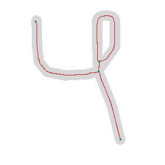            | 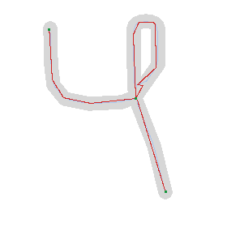            | 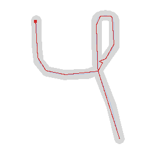            |
| 4, gap 14 px | 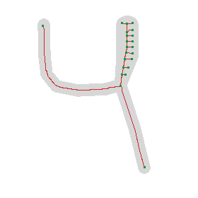            | 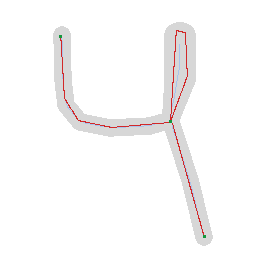            | 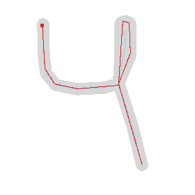            |
| 4, gap 6 px  | 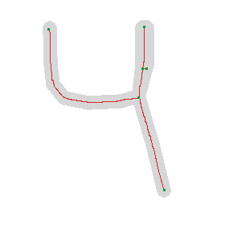             | 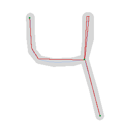             | 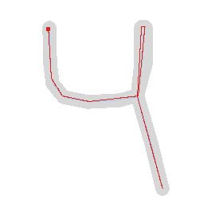             |
| `+`          |                    | 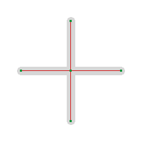                   | 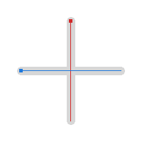                   |
| barred 7     | 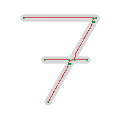                  | 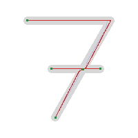                  | 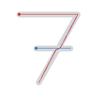                  |
| `A`          | 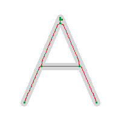                | 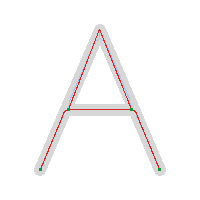                | 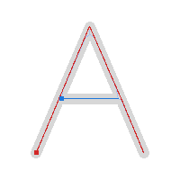                |
| recorded 7   | 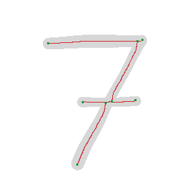 | 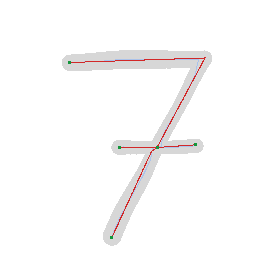 | 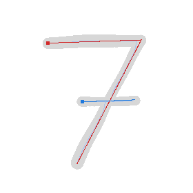 |

The stroke renders of `main` are kept next to them in [`images/`](images)
(`*-before-strokes.png`).

### Fewest points, manual down to one

From [`data/simplification.txt`](data/simplification.txt), with points and
ink match per digit:

| Digit       | fixed 0.85 px | Auto (MDL)     | budget 4  | budget 2  | budget 1  |
| ----------- | ------------- | -------------- | --------- | --------- | --------- |
| MNIST 0 (5) | 9 / 0.632     | 7 / 0.641 @1.7 | 4 / 0.653 | 2 / 0.352 | 1 / 0.102 |
| MNIST 1 (0) | 11 / 0.692    | 9 / 0.683 @1.7 | 4 / 0.505 | 2 / 0.320 | 1 / 0.134 |
| MNIST 6 (1) | 4 / 0.819     | 2 / 0.835 @1.7 | 2 / 0.835 | 2 / 0.835 | 1 / 0.193 |

Auto uses fewer points than the old fixed tolerance with the same match.
The budget keeps reducing points until one dot remains per shape.

### Indented Links Notation

The `+` (from `toLinksNotation`):

```
vectorization:
  raster 200 200
  pen 12.242
  network:
    p1: point 99.5 29.625
    p2: point 29.625 99.5
    p3: point 99.5 99.5
    p4: point 170.125 99.5
    p5: point 99.5 170.125
    l6: link p1 p3
      points (99.5 29.625) (99.5 99.5)
    l7: link p2 p3
      points (29.625 99.5) (99.5 99.5)
    l8: link p3 p4
      points (99.5 99.5) (170.125 99.5)
    l9: link p3 p5
      points (99.5 99.5) (99.5 170.125)
  strokes:
    stroke1:
      points (99.5 29.625) (99.5 170.125)
      steps:
        l6 p1 p3
        l9 p3 p5
    stroke2:
      points (29.625 99.5) (170.125 99.5)
      steps:
        l7 p2 p3
        l8 p3 p4
```

A pen recording ([`examples/recordings/seven-barred.lino`](../../../examples/recordings/seven-barred.lino)):

```
recording:
  canvas 280 280
  brush 9 18
  options:
    threshold 32
    alphaThreshold 24
  strokes:
    stroke1:
      pointer pen
      samples:
        70 62.8 0 0.35
        76.22 62.59 16.7 0.371
        …
```

## 5. Existing components and libraries

| Component                                                                                  | What it does                                  | Used? | Why                                                                                                                                                                                                                                                               |
| ------------------------------------------------------------------------------------------ | --------------------------------------------- | ----- | ----------------------------------------------------------------------------------------------------------------------------------------------------------------------------------------------------------------------------------------------------------------- |
| [links-notation](https://github.com/link-foundation/links-notation) (npm `links-notation`) | Links Notation parser                         | Yes   | already a dependency; parses the indented recordings and network documents ([`experiments/issue-7-lino-indented.mjs`](../../../experiments/issue-7-lino-indented.mjs))                                                                                            |
| [lino-objects-codec](https://github.com/link-foundation/lino-objects-codec)                | objects ↔ Links Notation, indented format     | Model | the issue names its indented form as the target style. We write the same structure by hand so every id stays a link reference (`l6 p1 p3`), not an object key                                                                                                     |
| [potrace](https://potrace.sourceforge.net/) (P. Selinger)                                  | outline tracing to Bézier curves              | No    | traces the outline of the ink, giving two lines per pen stroke; we need centerlines                                                                                                                                                                               |
| [AutoTrace](https://github.com/autotrace/autotrace) / Inkscape "Centerline tracing"        | centerline tracing                            | No    | no stroke order, pen lifts or per-shape point budget; users report node counts in the tens of thousands on rough scans ([Inkscape forum](https://inkscape.org/forums/questions/how-to-choose-settings-for-trace-bitmap-single-scan-centerline-tracing-autotrace)) |
| [vtracer](https://github.com/visioncortex/vtracer)                                         | color raster → vector regions                 | No    | region and outline based; no centerline                                                                                                                                                                                                                           |
| [skan](https://github.com/jni/skan), [sknw](https://github.com/Image-Py/sknw)              | skeleton → branch network (Python)            | No    | the same step as our `stroke-network.js`, but in Python; the package must run in the browser without dependencies                                                                                                                                                 |
| scikit-image `skeletonize`                                                                 | Zhang–Suen and Lee thinning (Python)          | No    | same reason; our `thinning.js` implements Zhang–Suen                                                                                                                                                                                                              |
| [simplify-js](https://github.com/mourner/simplify-js)                                      | RDP + radial-distance polyline simplification | No    | one tolerance per line; we need a tolerance per shape picked by description length, and a budget across a shape's strokes                                                                                                                                         |
| W3C InkML                                                                                  | XML format for pen traces                     | Model | the recording keeps InkML's channel model (`x y t pressure`) in Links Notation                                                                                                                                                                                    |

## 6. Reproducing the data

```bash
# before/after numbers: run once against main, once against this branch
git worktree add /tmp/nv-main a9b36c0
node experiments/issue-7-before-after.mjs /tmp/nv-main/src/index.js > docs/case-studies/issue-7/data/before-main.json
node experiments/issue-7-before-after.mjs > docs/case-studies/issue-7/data/after-pr.json
# before/after renders into images/
node experiments/issue-7-case-study-images.mjs /tmp/nv-main/src/index.js
# single experiments
node experiments/issue-7-four-loop.mjs        # data/four-loop.txt
node experiments/issue-7-pen-lifts.mjs        # data/pen-lifts.txt
node experiments/issue-7-simplification.mjs   # data/simplification.txt
node experiments/issue-7-mnist-strokes.mjs    # data/mnist-strokes.txt
node experiments/issue-7-auto-threshold-mnist.mjs # data/auto-threshold-mnist.txt
node experiments/issue-7-seven-kink.mjs       # data/seven-kink.txt
node experiments/issue-7-pressure-line.mjs    # data/pressure-line.txt
```

The browser checks
([`experiments/issue-7-app-draw-check.js`](../../../experiments/issue-7-app-draw-check.js),
[`experiments/issue-7-app-load-check.js`](../../../experiments/issue-7-app-load-check.js))
run in Playwright against `npm run example:web` and produced the
screenshots in [`docs/screenshots/issue-7`](../../screenshots/issue-7) and
[`data/app-saved-recording.json`](data/app-saved-recording.json). The drawn
barred 7 was vectorized as 2 strokes and 5 points. The loaded recording with
"Max points per shape" set to 1 was reduced to 1 point.

## 7. Limitations

- **Fused loops** are recognised by ink wider than the median pen
  (8 % and at least 1 px more). A drawing where every stroke is pressed
  equally hard has no thin reference, so a filled blob of uniform width is
  still a line. [`data/pressure-line.txt`](data/pressure-line.txt) shows a
  line whose middle is pressed to a radius of 6–18 px staying one link, with
  no stubs. Its ink coverage falls to 0.70–0.75 at large radii because an SVG
  stroke has one width along its whole length.
- **Pen lifts** are decided by a single cost (`penLiftCost`, default 2.5 pen
  widths). A writer who draws a `+` in one movement gets two strokes. Set
  `penLifts: false` (web app: Pen lifts "Never") for a single stroke.
- **Auto threshold** uses Otsu. On MNIST it keeps slightly more ink than the
  fixed 32 (mask coverage 0.985 compared with 0.982) but uses 345 points
  instead of 325 ([`data/auto-threshold-mnist.txt`](data/auto-threshold-mnist.txt)).
  The web app uses Auto; the library keeps 32 as its default unless
  `foreground: 'auto'` is given.
- **A budget of one point** draws each shape as a dot. That is what the
  issue asked for as the manual extreme, and its ink match is accordingly
  low (0.08–0.24 on MNIST).
